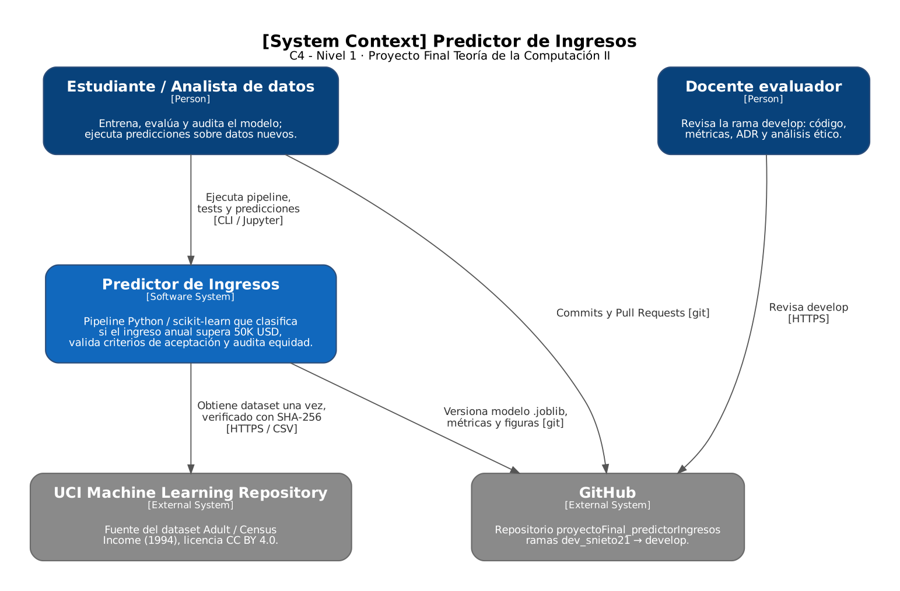
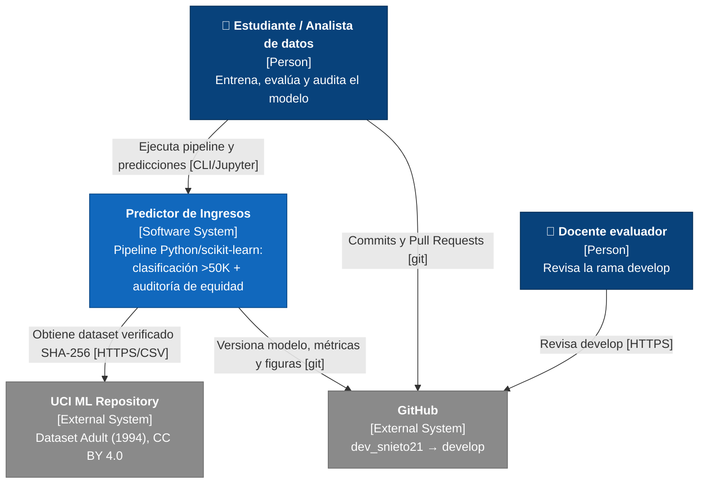
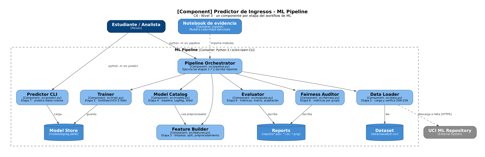
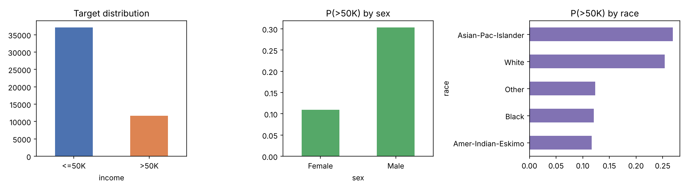
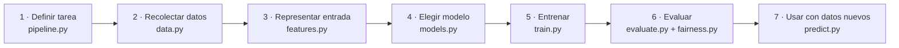
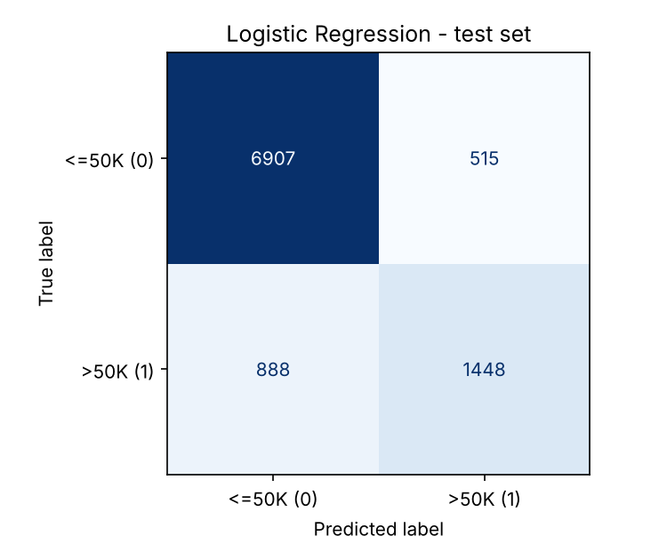

# proyectoFinal_predictorIngresos

[](https://github.com/santnier92/proyectoFinal_predictorIngresos/actions/workflows/ci.yml)

**Proyecto Final (Actividad 6) — Teoría de la Computación II**
Ingeniería de Software · Universidad de La Salle
Autor: **Santiago Nieto Rodríguez** · rama de trabajo `dev_snieto21` → integración en `develop`

> Clasificador de **Regresión Logística** que estima si el ingreso anual de una persona supera **50.000 USD** a partir del dataset *Adult / Census Income* (UCI). El proyecto **evalúa el modelo con métricas cuantitativas** y **audita sus sesgos** desde una perspectiva ética.

📄 El desarrollo completo de la actividad (métricas interpretadas, matriz de confusión, análisis ético, conclusiones y recomendaciones) está en **[`docs/Informe_Actividad6.pdf`](docs/Informe_Actividad6.pdf)**.

---

## Tabla de contenido
1. [Problema que resuelve](#1-problema-que-resuelve)
2. [Qué hará y qué no hará el sistema](#2-qué-hará-y-qué-no-hará-el-sistema)
3. [Arquitectura del sistema (C4 de contexto y componentes)](#3-arquitectura-del-sistema)
4. [Datos](#4-datos)
5. [Cómo funciona la solución](#5-cómo-funciona-la-solución)
6. [Decisiones de arquitectura (ADR)](#6-decisiones-de-arquitectura-adr)
7. [Calidad y evaluación del modelo](#7-calidad-y-evaluación-del-modelo)
8. [Riesgos técnicos](#8-riesgos-técnicos)
9. [Cómo ejecutar y demostrar los resultados](#9-cómo-ejecutar-y-demostrar-los-resultados)
10. [Glosario](#10-glosario)
11. [Referencias](#11-referencias)

---

## 1. Problema que resuelve

Las decisiones automatizadas que dependen del nivel de ingresos de una persona (otorgar un crédito, focalizar un subsidio, segmentar clientes) suelen apoyarse en modelos entrenados con datos históricos. Este proyecto construye uno de esos modelos **de forma controlada** para responder dos preguntas:

1. **Técnica:** ¿qué tan bien predice un modelo básico si una persona gana más de 50K USD al año y cómo se demuestra que ese resultado es válido?
2. **Ética:** ¿qué sesgos hereda el modelo de los datos, a quién perjudican sus errores y en qué condiciones sería responsable usarlo?

**Frase de propósito:** *construir, evaluar y auditar un clasificador de ingresos reproducible, cuyos resultados puedan verificarse con métricas, pruebas automatizadas y un análisis de equidad.*

| Ficha de contexto | |
|---|---|
| **Objetivo** | Clasificar `income` en `>50K` (1) o `<=50K` (0) y medir su desempeño y su equidad |
| **Alcance incluido** | Pipeline de datos, 3 modelos comparados + baseline, métricas, matriz de confusión, auditoría por sexo, raza y país, CLI de predicción |
| **Exclusiones** | API web, despliegue en la nube, reentrenamiento automático, datos personales reales |
| **Criterio de éxito** | Cumplir los 5 criterios de aceptación de la [sección 7](#7-calidad-y-evaluación-del-modelo) |
| **Supuestos** | Los datos del censo de 1994 sirven como caso de estudio; los resultados no se extrapolan a la población actual |

## 2. Qué hará y qué no hará el sistema

| ✅ El sistema **SÍ** | ❌ El sistema **NO** |
|---|---|
| Carga el dataset y verifica su integridad (SHA-256) | No usa datos de personas reales ni datos actuales |
| Limpia, deduplica y parte los datos sin fuga de información | No toma decisiones automáticas sobre personas (solo apoya el análisis) |
| Entrena y compara baseline, Regresión Logística, Árbol de Decisión y una Regresión Logística sin atributos sensibles | No expone una API ni un servicio web en línea |
| Calcula accuracy, precision, recall, F1 y ROC-AUC, y genera la matriz de confusión | No se reentrena solo ni monitorea la deriva de los datos en producción |
| Audita la equidad por sexo, raza y país de origen | No corrige los sesgos de forma automática (los mide y propone mitigaciones) |
| Predice la probabilidad de `>50K` para registros nuevos desde un CSV, con umbral configurable | No predice el ingreso exacto (no es una regresión) |
| Verifica los criterios de aceptación con `pytest` | No garantiza validez fuera de EE. UU. ni fuera de 1994 |

## 3. Arquitectura del sistema

La arquitectura sigue el proceso visto en clase: interesados → drivers → escenarios de calidad → estructura (C4) → estilo y tácticas → decisiones (ADR).

### 3.1 Interesados y sus preocupaciones

| Interesado | Preocupación | Resultado esperado |
|---|---|---|
| Docente evaluador | ¿El trabajo es verificable y cumple la rúbrica? | Rama `develop` revisable, resultados reproducibles |
| Estudiante / Analista | ¿Cómo entreno, evalúo y uso el modelo? | Un comando por etapa, pruebas automáticas |
| Personas representadas en los datos | ¿El modelo las trata de forma justa? | Auditoría de equidad por sexo, raza y país |
| Seguridad y datos | ¿Se protege la información sensible? | Dataset público y anonimizado, integridad SHA-256, sin servicio expuesto |

### 3.2 Drivers arquitectónicos (priorizados)

| Prioridad | Clase | Driver | Efecto sobre la arquitectura |
|---|---|---|---|
| P1 | Atributo de calidad | **Reproducibilidad**: los mismos datos y el mismo código producen los mismos números | Semilla fija, dataset con hash, pipeline por CLI (ADR-001, ADR-003) |
| P1 | Atributo de calidad | **Validez de la evaluación**: sin fuga de información y comparada contra un baseline | Pipeline de scikit-learn, split estratificado, tests (ADR-004) |
| P1 | Resultado académico | **Evidencia por etapa** del workflow de ML | Un componente por etapa + notebook ejecutado |
| P2 | Atributo de calidad | **Interpretabilidad / transparencia** para el análisis ético | Regresión Logística con coeficientes (ADR-002) |
| P2 | Riesgo | **Sesgo** del dataset de 1994 | Componente Fairness Auditor y métricas por grupo |
| P3 | Restricción | Costo cero y sin credenciales de nube | Ejecución local, artefactos en Git (ADR-003) |

### 3.3 Escenarios de calidad medibles

*Plantilla: cuando [estímulo] en [entorno], el sistema [respuesta], medido con [medida].*

| Atributo | Estímulo | Entorno | Respuesta | Medida | Prioridad |
|---|---|---|---|---|---|
| Reproducibilidad | El docente clona `develop` y ejecuta el pipeline | Máquina con Python 3.10+ | Regenera modelo y reportes | Métricas idénticas a `reports/metrics.json` (4 decimales); < 60 s | P1 |
| Validez | Se ejecuta `pytest` | Tras entrenar | Verifica fuga, baseline y aceptación | 6/6 pruebas superadas | P1 |
| Desempeño del modelo | Se evalúa el conjunto de prueba | Hold-out nunca visto | Clasifica `>50K` | F1 ≥ 0.60 y ROC-AUC ≥ 0.85 | P1 |
| Integridad de datos | El CSV de entrada es alterado | Carga de datos | El pipeline se detiene con error | 100 % de alteraciones detectadas (SHA-256) | P2 |
| Robustez de la entrada | Llega un CSV sin columnas requeridas | Predicción por CLI | Rechaza la entrada con un mensaje claro | `ValueError` que lista las columnas faltantes | P2 |
| Equidad | Se audita el modelo | Test, por grupo | Reporta brechas por sexo y raza | Diferencias de TPR y de tasa de selección publicadas en `reports/` | P2 |

### 3.4 Diagrama C4 de contexto (nivel 1)



<details>
<summary>Versión Mermaid (editable)</summary>


</details>

Fuente del diagrama: [`docs/diagramas/c4-contexto.dot`](docs/diagramas/c4-contexto.dot) (Graphviz).

### 3.5 Estilo arquitectónico y tácticas

**Estilo: tuberías y filtros (pipes and filters) en un monolito modular.** Cada etapa del workflow de ML es un filtro con una sola responsabilidad que recibe datos de la anterior. Este estilo responde a los drivers P1 (evidencia por etapa y reproducibilidad) sin la complejidad de microservicios o eventos, que no se justifican para un proceso batch de un solo usuario.

| Escenario prioritario | Táctica | Efecto y costo |
|---|---|---|
| Reproducibilidad | Semilla fija, dataset versionado con hash y dependencias declaradas | Resultados idénticos; el repo pesa ~5 MB más |
| Validez (sin fuga) | Preprocesamiento encapsulado en `Pipeline` y deduplicación antes de partir | El test nunca influye en el ajuste; exige disciplina en el diseño |
| Integridad de datos | Verificación SHA-256 en cada carga | Detecta cambios; el hash debe actualizarse si cambia el dataset |
| Robustez de la entrada | Validación del contrato de columnas en `predict` | Errores claros; hay que mantener la lista de columnas |
| Detección de regresiones | Pruebas automatizadas + CI en GitHub Actions | Un PR que degrade las métricas falla; ~1 min de CI |
| Transparencia | Modelo lineal interpretable + métricas por grupo | Permite explicar decisiones; cede ~1 punto de accuracy |

### 3.6 Diagrama C4 de componentes (nivel 3)

Zoom al contenedor **ML Pipeline**: un componente por etapa del workflow, más los almacenes de datos que usa.



Fuente: [`docs/diagramas/c4-componentes.dot`](docs/diagramas/c4-componentes.dot).

| Componente | Responsabilidad | Etapa |
|---|---|---|
| Pipeline Orchestrator (`src/pipeline.py`) | Coordina las etapas y escribe los reportes | 1–7 |
| Data Loader (`src/data.py`) | Carga el dataset y verifica su integridad | 2 |
| Feature Builder (`src/features.py`) | Limpia, parte y transforma los datos | 3 |
| Model Catalog (`src/models.py`) | Define los candidatos y sus grillas | 4 |
| Trainer (`src/train.py`) | Ajusta hiperparámetros con CV y persiste el modelo | 5 |
| Evaluator (`src/evaluate.py`) | Métricas, matriz de confusión, ROC y aceptación | 6 |
| Fairness Auditor (`src/fairness.py`) | Métricas por grupo protegido | 6 |
| Predictor CLI (`src/predict.py`) | Valida la entrada y predice registros nuevos | 7 |

## 4. Datos

**Dataset:** *Adult / Census Income* — Becker, B. & Kohavi, R. (1996), UCI Machine Learning Repository, licencia **CC BY 4.0**. Proviene del censo de EE. UU. de 1994; se usa la unión de `adult.data` y `adult.test` (**48,842 registros × 15 columnas**), versionada en [`data/raw/adult.csv`](data/raw/adult.csv).

| Variable | Tipo | Descripción | Uso |
|---|---|---|---|
| `age` | numérica | Edad | feature |
| `workclass` | categórica | Tipo de empleador (privado, gobierno, independiente…) | feature |
| `fnlwgt` | numérica | Peso muestral del censo (no es un atributo de la persona) | **descartada** |
| `education` | categórica | Nivel educativo en texto | **descartada** (redundante) |
| `education_num` | numérica | Nivel educativo codificado de 1 a 16 | feature |
| `marital_status` | categórica | Estado civil | feature (*proxy* de sexo) |
| `occupation` | categórica | Ocupación | feature |
| `relationship` | categórica | Rol en el hogar (Husband, Wife, Own-child…) | feature (*proxy* de sexo) |
| `race` | categórica | Raza | feature **sensible** |
| `sex` | categórica | Sexo | feature **sensible** |
| `capital_gain` / `capital_loss` | numéricas | Ganancias y pérdidas de capital | features |
| `hours_per_week` | numérica | Horas trabajadas por semana | feature |
| `native_country` | categórica | País de origen | feature **sensible** |
| **`income`** | binaria | **Objetivo:** `>50K` (1) o `<=50K` (0) | **target** |

**Perfil:** 23.9 % de positivos (desbalance), 52 duplicados y valores faltantes (`?`) en `workclass` (2,799), `occupation` (2,809) y `native_country` (857). Brecha histórica: el 30.4 % de los hombres gana `>50K` frente al 10.9 % de las mujeres.



## 5. Cómo funciona la solución

El código sigue las **7 etapas del workflow de Machine Learning**, con un módulo por etapa:



| Etapa | Qué se hace | Evidencia |
|---|---|---|
| 1. Definir la tarea | Clasificación binaria `>50K` vs `<=50K` | `notebooks/workflow_ml.ipynb` |
| 2. Recolectar datos | Carga del CSV con verificación SHA-256 y perfil del dataset | `src/data.py`, figura EDA |
| 3. Representar la entrada | Deduplicación, descarte de `fnlwgt`/`education`, partición estratificada 80/20, imputación + escalado + one-hot (84 variables) | `src/features.py` |
| 4. Elegir el modelo | Baseline vs Regresión Logística vs Árbol vs Regresión Logística sin atributos sensibles | `src/models.py`, ADR-002 |
| 5. Entrenar | `GridSearchCV` con 5 folds estratificados, optimizando F1 | `src/train.py`, `models/logreg.joblib` |
| 6. Evaluar | Métricas, matriz de confusión, ROC, análisis de umbral, coeficientes, auditoría de equidad, criterios de aceptación | `src/evaluate.py`, `src/fairness.py`, `reports/` |
| 7. Usar con datos nuevos | CLI que predice probabilidad y clase para un CSV | `src/predict.py`, `data/sample_new_people.csv` |

### Estructura del repositorio

```
proyectoFinal_predictorIngresos/
├── .github/workflows/ci.yml   # CI: pipeline + pytest en cada push/PR
├── ADRs/                      # Architecture Decision Records (4)
├── data/
│   ├── raw/adult.csv          # Dataset original (CC BY 4.0)
│   └── sample_new_people.csv  # Registros de ejemplo para la etapa 7
├── docs/
│   ├── Informe_Actividad6.pdf # Desarrollo completo de la actividad
│   ├── build_report.py        # Regenera el PDF desde reports/metrics.json
│   └── diagramas/             # C4 de contexto y de componentes (.dot y .png)
├── models/logreg.joblib       # Pipeline entrenado (preprocesamiento + modelo)
├── notebooks/workflow_ml.ipynb# Evidencia ejecutada de cada etapa
├── reports/                   # metrics.json, comparaciones, auditoría de equidad, figuras
├── src/                       # Un módulo por etapa del workflow
├── tests/test_pipeline.py     # Integridad, fuga de información y aceptación
└── requirements.txt
```

## 6. Decisiones de arquitectura (ADR)

Cada ADR sigue la plantilla de [ZAITects](https://github.com/TheKataLog/ZAITects/tree/main/ADRs): *Estado, Contexto, Alternativas, PrOACT, Decisión, Consecuencias, Tradeoffs - Mitigations* y *Validación*.

| ADR | Decisión | Estado |
|---|---|---|
| [ADR-001](ADRs/ADR-001-enfoque-de-implementacion.md) | **Enfoque de implementación:** pipeline modular en Python/scikit-learn + notebook de evidencia (en lugar de un notebook monolítico o SageMaker) | Aceptada |
| [ADR-002](ADRs/ADR-002-seleccion-del-modelo.md) | **Selección del modelo:** Regresión Logística por interpretabilidad y probabilidades útiles, con desempeño equivalente al Árbol de Decisión | Aceptada |
| [ADR-003](ADRs/ADR-003-almacenamiento-y-despliegue.md) | **Almacenamiento y despliegue:** CSV con SHA-256 + modelo `.joblib` versionados en Git; uso por CLI local | Aceptada |
| [ADR-004](ADRs/ADR-004-separacion-de-datos-y-metrica-principal.md) | **Separación de datos y métrica:** hold-out estratificado 80/20 + CV 5 folds; F1 como métrica principal | Aceptada |

## 7. Calidad y evaluación del modelo

### Estrategia de separación de datos
- Deduplicación **antes** de partir los datos → 48,790 registros.
- **Hold-out estratificado 80/20** (`random_state=42`): train 39,032 / test 9,758, ambos con 23.9 % de positivos.
- **Validación cruzada estratificada de 5 folds** solo sobre train para los hiperparámetros.
- Preprocesamiento dentro del `Pipeline` → **sin fuga de información**.

### Comparación con el modelo de referencia (conjunto de prueba)

| Modelo | Accuracy | Precision | Recall | F1 | ROC-AUC |
|---|---|---|---|---|---|
| Baseline (siempre `<=50K`) | 0.7606 | 0.0000 | 0.0000 | 0.0000 | 0.5000 |
| **Regresión Logística** ⭐ | **0.8562** | **0.7376** | **0.6199** | **0.6736** | **0.9095** |
| Árbol de Decisión | 0.8660 | 0.7888 | 0.6010 | 0.6822 | 0.9113 |
| Regresión Logística sin `sex`/`race`/`native_country` | 0.8554 | 0.7385 | 0.6130 | 0.6699 | 0.9090 |

**Interpretación breve** (el detalle está en el informe PDF):
- **Accuracy 0.856:** acierta en el 85.6 % de los casos, pero el baseline ya logra 76 % sin aprender nada; la ganancia real es de **+9.6 puntos**.
- **Precision 0.738:** de cada 100 personas que el modelo clasifica como `>50K`, 74 lo son.
- **Recall 0.620:** detecta el 62 % de quienes realmente ganan `>50K`; se le escapa el 38 %.
- **F1 0.674:** equilibrio entre precisión y recall; el baseline obtiene 0.
- **ROC-AUC 0.910:** en 91 de cada 100 parejas (una positiva y una negativa), el modelo asigna mayor probabilidad a la positiva.

### Matriz de confusión (Regresión Logística, test)

|  | Predicho `<=50K` | Predicho `>50K` |
|---|---|---|
| **Real `<=50K`** | VN = **6,907** | FP = **515** |
| **Real `>50K`** | FN = **888** | VP = **1,448** |



### Criterios de aceptación del software

| # | Criterio | Umbral | Resultado | Estado |
|---|---|---|---|---|
| 1 | F1 de la clase `>50K` en test | ≥ 0.60 | 0.6736 | ✅ |
| 2 | ROC-AUC en test | ≥ 0.85 | 0.9095 | ✅ |
| 3 | Ganancia de accuracy frente al baseline | ≥ 0.05 | +0.0956 | ✅ |
| 4 | Brecha de F1 entre train y test (sobreajuste) | ≤ 0.03 | 0.0148 | ✅ |
| 5 | Desviación estándar del F1 en CV de 5 folds (estabilidad) | ≤ 0.02 | 0.0118 | ✅ |

Los criterios se verifican de forma automática en `tests/test_pipeline.py` (6 pruebas: checksum, ausencia de fuga, perfiles repetidos, superioridad frente al baseline, aceptación y contrato de predicción).

### Equidad (resumen)

| Atributo | Diferencia de paridad demográfica | Diferencia de igualdad de oportunidad (TPR) |
|---|---|---|
| Sexo (H vs M) | 0.199 | 0.170 (TPR hombres 0.648 vs mujeres 0.478) |
| Raza (grupos con n ≥ 100) | 0.166 | 0.216 (TPR personas negras 0.460) |
| País (EE. UU. vs resto) | 0.045 | 0.004 |

Quitar `sex`, `race` y `native_country` **casi no reduce** las brechas (paridad por sexo: 0.199 → 0.192), porque `relationship` y `marital_status` actúan como variables *proxy*. El análisis completo está en el [informe PDF](docs/Informe_Actividad6.pdf).

## 8. Riesgos técnicos

| # | Riesgo | Impacto | Probabilidad | Mitigación aplicada / propuesta |
|---|---|---|---|---|
| R1 | **Fuga de información entre conjuntos** (duplicados o preprocesamiento ajustado con todo el dataset) | Alto: métricas optimistas y falsas | Media | Deduplicación antes de partir los datos; todo el preprocesamiento dentro del `Pipeline`; tests `test_no_leakage…` y `test_overlapping_profiles…` (F1 en perfiles no vistos 0.691 ≥ perfiles vistos 0.602) |
| R2 | **Sesgos del dataset** (censo de 1994: brecha por sexo y raza, 85.5 % de personas blancas) | Alto: el modelo discrimina a grupos protegidos (TPR de mujeres 0.48 vs hombres 0.65) | Alta (confirmada) | Auditoría de equidad por grupo; experimento sin atributos sensibles; recomendaciones de mitigación (umbrales por grupo, reponderación, Fairlearn); uso exclusivamente académico |
| R3 | **Sobreajuste** | Medio: bajo desempeño en datos nuevos | Baja | Regularización (C ajustado por CV); árbol limitado en profundidad y tamaño de hoja; criterio de brecha train-test ≤ 0.03 (real: 0.015) |
| R4 | **Datos insuficientes o desactualizados** (grupos pequeños, como Amer-Indian-Eskimo con ~470 registros; datos de 1994) | Medio: métricas poco confiables en minorías y deriva temporal | Alta | Se reportan solo grupos con n ≥ 100; se declara la validez limitada a 1994/EE. UU.; se recomienda reentrenar con datos recientes |
| R5 | **Limitaciones de cómputo y serialización** (GridSearch costoso; `.joblib` depende de la versión de scikit-learn y puede ejecutar código) | Bajo | Baja | Grillas pequeñas y `n_jobs=-1` (~20 s); versión mínima en `requirements.txt`; solo se cargan modelos generados por el propio pipeline |

## 9. Cómo ejecutar y demostrar los resultados

```bash
# 1. Clone the repository and switch to the integration branch
git clone https://github.com/santnier92/proyectoFinal_predictorIngresos.git
cd proyectoFinal_predictorIngresos
git checkout develop

# 2. Create a virtual environment and install dependencies
python -m venv .venv
source .venv/bin/activate          # Windows: .venv\Scripts\activate
pip install -r requirements.txt

# 3. Run the full ML workflow (stages 1-7) -> models/, reports/
python -m src.pipeline

# 4. Validate acceptance criteria
python -m pytest -q                # expected: 6 passed

# 5. Predict on new data (stage 7)
python -m src.predict --input data/sample_new_people.csv
python -m src.predict --input data/sample_new_people.csv --threshold 0.35

# 6. (Optional) Re-execute the evidence notebook and rebuild the PDF report
jupyter nbconvert --to notebook --execute --inplace notebooks/workflow_ml.ipynb
pip install reportlab && python docs/build_report.py
```

**¿Cómo se demuestra que los resultados son válidos?**
1. **Reproducibilidad:** semilla fija y dataset verificado con hash; el mismo comando produce los mismos números.
2. **Conjunto de prueba aislado:** nunca se usa en el entrenamiento ni en la selección de hiperparámetros.
3. **Comparación con el baseline:** el modelo debe superar a la estrategia trivial.
4. **Estabilidad:** media ± desviación en 5 folds.
5. **Pruebas automatizadas e integración continua:** GitHub Actions ejecuta el pipeline y `pytest` en cada push y Pull Request; si un criterio de aceptación no se cumple, el build falla.

## 10. Glosario

| Término | Definición |
|---|---|
| **Accuracy** | Proporción de predicciones correctas sobre el total. |
| **ADR** | *Architecture Decision Record*: documento breve que registra una decisión, su contexto, las alternativas y sus consecuencias. |
| **Baseline** | Modelo de referencia trivial (aquí, siempre predice la clase mayoritaria) que cualquier modelo útil debe superar. |
| **C4 (contexto)** | Primer nivel del modelo C4 de Simon Brown: muestra el sistema, sus usuarios y los sistemas externos. |
| **Clase positiva** | La que interesa detectar: `>50K` (1). |
| **Desbalance de clases** | Una clase es mucho más frecuente que la otra (76 % vs 24 %). |
| **Diferencia de paridad demográfica** | Diferencia entre grupos en la tasa de predicciones positivas. Lo ideal es 0. |
| **Diferencia de igualdad de oportunidad** | Diferencia entre grupos en el recall (TPR). Lo ideal es 0. |
| **F1-score** | Media armónica de precision y recall. |
| **Fuga de información (*data leakage*)** | Información del conjunto de prueba que se filtra al entrenamiento e infla las métricas. |
| **Hold-out estratificado** | Partición train/test que conserva la proporción de clases. |
| **Matriz de confusión** | Tabla 2×2 que cruza clase real y predicha: VP, FP, VN, FN. |
| **One-hot encoding** | Convierte cada categoría en una columna binaria. |
| **Pipeline** | Cadena de transformaciones + modelo que se ajusta como una sola unidad. |
| **Precision** | De los predichos positivos, cuántos lo son realmente: VP / (VP + FP). |
| **Proxy (variable)** | Variable no sensible que está correlacionada con un atributo sensible (p. ej., `relationship=Wife` → sexo). |
| **Recall / TPR** | De los positivos reales, cuántos detecta el modelo: VP / (VP + FN). |
| **Regresión Logística** | Modelo lineal que estima la probabilidad de la clase positiva mediante la función sigmoide. |
| **ROC-AUC** | Área bajo la curva ROC: capacidad de ordenar positivos sobre negativos, independiente del umbral. |
| **Sobreajuste** | El modelo memoriza el entrenamiento y generaliza mal. |
| **Umbral de decisión** | Probabilidad a partir de la cual se predice la clase positiva (0.5 por defecto). |
| **Validación cruzada (k-fold)** | Se entrena y valida k veces con particiones distintas para estimar estabilidad. |

## 11. Referencias

**Dataset**
- Becker, B., & Kohavi, R. (1996). *Adult* [Dataset]. UCI Machine Learning Repository. https://doi.org/10.24432/C5XW20 — https://archive.ics.uci.edu/dataset/2/adult
- Kohavi, R. (1996). Scaling Up the Accuracy of Naive-Bayes Classifiers: a Decision-Tree Hybrid. *Proceedings of KDD-96*.
- Espejo CSV utilizado: https://github.com/jbrownlee/Datasets (`adult-all.csv`, unión de `adult.data` + `adult.test`).

**Herramientas**
- Pedregosa, F. et al. (2011). Scikit-learn: Machine Learning in Python. *JMLR 12*, 2825-2830. https://scikit-learn.org
- pandas, NumPy, Matplotlib, Jupyter, pytest, Graphviz.

**Arquitectura y decisiones técnicas**
- Brown, S. *The C4 model for visualising software architecture.* https://c4model.com/diagrams/system-context
- Nygard, M. (2011). *Documenting Architecture Decisions.* https://cognitect.com/blog/2011/11/15/documenting-architecture-decisions
- TheKataLog / ZAITects — ejemplos de ADR: https://github.com/TheKataLog/ZAITects/tree/main/ADRs
- Santibáñez, C. — ejemplo de pipeline de ML: https://github.com/christian-santibanez/ml-ops-production-pipeline

**Ética y equidad**
- Barocas, S., Hardt, M., & Narayanan, A. (2023). *Fairness and Machine Learning: Limitations and Opportunities.* MIT Press. https://fairmlbook.org
- Hardt, M., Price, E., & Srebro, N. (2016). Equality of Opportunity in Supervised Learning. *NeurIPS 2016*.
- Mitchell, M. et al. (2019). Model Cards for Model Reporting. *FAT\* 2019*.
- Ley 1581 de 2012 (Colombia) — Protección de datos personales.
